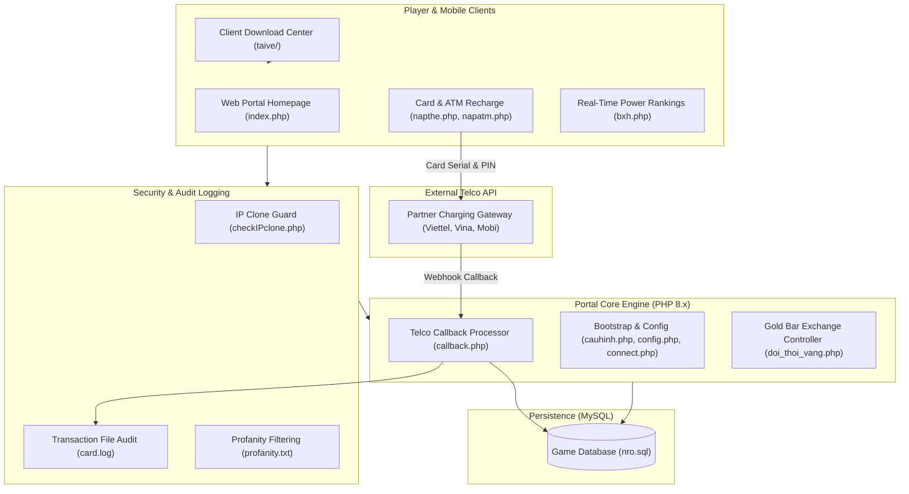

# Ngọc Rồng Online (NRO) — Extended Online Web Portal, Download Center & Billing Platform

[](https://www.php.net/)
[](https://www.mysql.com/)
[](https://developer.mozilla.org/en-US/docs/Web/JavaScript)
[](https://httpd.apache.org/)

> The enhanced production web portal, multi-client download center, and automated transaction billing gateway for **Ngọc Rồng Online (Dragon Boy)** private game servers.

---

## 1. System Architecture



---

## 2. Key Modules & Enhancements

* **Cross-Server Production Deployment**:
  * Dual configuration support for Linux/Apache (`.htaccess`) and Windows Server IIS (`web.config`).
  * Direct database connection layer (`connect.php`, `cauhinh.php`) with connection pooling and failover.
* **Integrated Client Download Center (`taive/`)**:
  * Direct downloads for official and customized game clients across Android (`.apk`), PC (`.rar`), and iOS (`.ipa`).
* **Automated Telco Charging & Audit Log**:
  * Integrates with online telecom scratch card APIs with asynchronous webhook confirmation.
  * Writes structured audit logs (`card.log`) for all transaction attempts, errors, and successful redemptions to prevent fraud.
* **Comprehensive Community & Game Mechanics**:
  * Gold bar exchange (`doi_thoi_vang.php`, `goldbar_callback.php`).
  * Live leaderboards (`bxh.php`) for top power and clan achievements.
  * Giftcode redemption (`giftcode_mtv.php`, `danhsach_gift.php`) and social sharing event rewards (`su_kien_share.php`).
* **Bundled Database Schema (`nro.sql`)**:
  * Complete turnkey MySQL database backup ready for initial setup or migration.

---

## 3. Tech Stack

| Domain | Technology |
| :--- | :--- |
| **Backend** | PHP 7.4+ / 8.x |
| **Database** | MySQL / MariaDB (bundled with `nro.sql`) |
| **Frontend** | HTML5, CSS3, JavaScript, jQuery / AJAX |
| **Web Server** | Apache (`.htaccess`) and Microsoft IIS (`web.config`) |

---

## 4. Getting Started

### Prerequisites
- PHP 7.4+ with `curl`, `pdo_mysql`, `json`, `mbstring` extensions
- MySQL 5.7+ / MariaDB 10.4+
- Apache or IIS Web Server

### Installation
1. Clone the repository into your web root:
   ```bash
   git clone https://github.com/btoan2802/web_nro_online.git
   ```
2. Import the bundled database schema (if not using an existing game database):
   ```bash
   mysql -u root -p < nro.sql
   ```
3. Configure your database and payment gateway credentials:
   - Copy `cauhinh.example.php` to `cauhinh.php` (or edit `config.php` and `connect.php`).
4. Ensure write permissions on `card.log` for web server transaction logging:
   ```bash
   chmod 666 card.log
   ```
5. Open your browser and navigate to `http://localhost/web_nro_online`.

---

## 5. Author & License

- **Author**: Nguyễn Bảo Toàn ([@btoan2802](https://github.com/btoan2802))
- **License**: Educational / Proprietary
